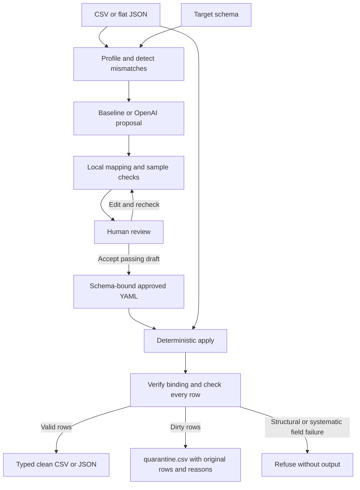
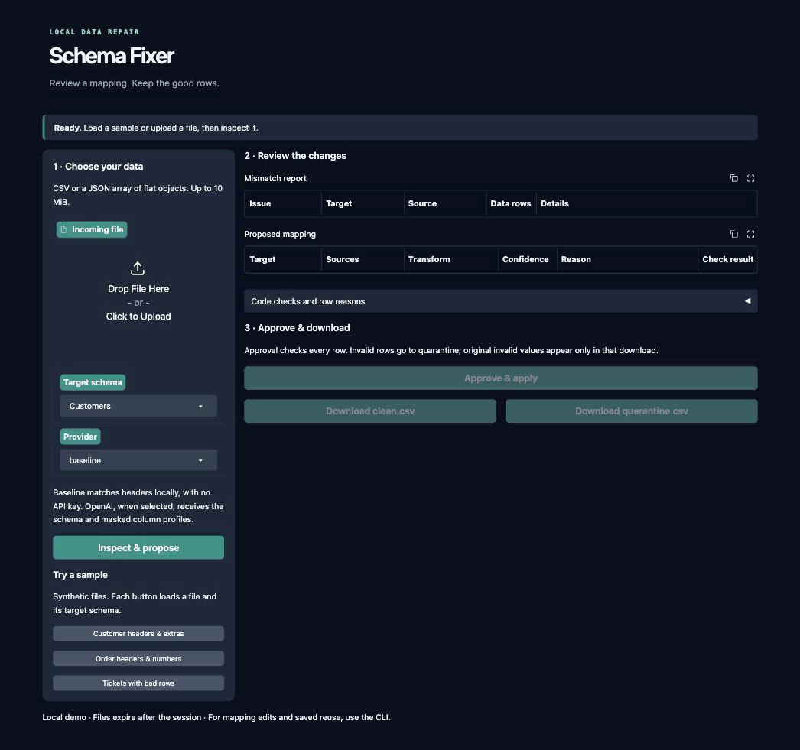

# Schema Fixer

Incoming CSV and JSON exports often use different headers, date formats and enum labels from the schema an import expects. Schema Fixer profiles those differences, proposes a small declarative mapping, checks it locally, and requires human approval before writing clean data. Bad rows go to a separate quarantine file with their row numbers and reasons.

The baseline provider matches headers without an API key. The OpenAI provider receives only the target schema and masked column profiles, and chooses from fixed transforms. It cannot write or execute code. Approved mappings can be reused with no LLM call.



## Results

Measured on 2026-11-06: one baseline pass and one live `gpt-6-luna` pass, 20 cases each, no retries.

| Provider | Output match | Strict pass | Field accuracy | Missing recall | Confident wrong | Quarantine exact | API errors | Cost/file USD | Total USD | p50 seconds |
|---|---:|---:|---:|---:|---:|---:|---:|---:|---:|---:|
| baseline | 8/20 | 8/20 | 86/110 (78.2%) | 3/3 (100.0%) | 7/90 (7.8%) | 8/20 | 0 | $0.000000 | $0.000000 | 0.000018 |
| openai | 15/20 | 2/20 | 88/110 (80.0%) | 3/3 (100.0%) | 18/101 (17.8%) | 16/20 | 0 | $0.000262 | $0.005249 | 4.590984 |

**Output match** is the headline. A case matches when the proposed mapping produces the same clean values and the same quarantined rows as the reviewed answer on that case's rows. This is execution-based scoring, the same idea as execution accuracy in text-to-SQL benchmarks. **Strict pass** also requires the same transform. 13 of OpenAI's 15 matches fail strict scoring only because it picked an equivalent transform, such as parsing a date that was already ISO, or mapping `high` to `high`. All 18 of its high-confidence mismatches are in that group. Output match was added after the run and rescored from the saved attempts. No provider was called again and the prompt was not changed.

Output match is measured on the supplied rows only. Two transforms that agree there can still differ on unseen data: `parse_date` with `%Y-%m-%d` accepts `2026-1-6`, which a plain rename rejects.

**What the LLM gets wrong.** In 3 of its 5 misses, one bad value made it discard a whole column instead of mapping the good values and letting the bad row go to quarantine: `plan` in case 06 (unknown `Enterprise`), `quantity` in case 10 (`many`) and `priority` in case 20 (unknown `P9`). Case 13 lists a `total` column that does not exist as dropped, and case 19 drops `phone`, which the reference keeps. Its failure mode is too much caution, not invented values.

The full [evaluation report](eval/results.md) includes denominators, per-case latency/token usage, every failure, and scoring rules. [Saved attempts](eval/runs/m4-20261106/manifest.json) let the report be rebuilt without repeating API calls.

An output match or strict pass means the provider's decisions match the reviewed reference, including correct abstention. It does not approve a mapping. Case 19 correctly leaves required `status` unmapped because the provider cannot see the human's resolved-only export contract. The answer key's constant is the post-approval result. Rename and cast to the schema's own type are equivalent for scoring.

## Run locally

Requires Python 3.12 and [uv](https://docs.astral.sh/uv/). From the repository folder:

Start the local demo with no API key:

```sh
uv sync --locked
uv run python app.py
```

Open the local URL printed in the terminal (normally http://127.0.0.1:7860). Load **Tickets with bad rows**, click **Inspect & propose**, review the mismatch/mapping tables, then click **Approve & apply**. This sample produces one clean row and quarantines data rows 2 and 3, with plain reasons such as `requester_email: not a valid email address; subject: required value is blank`. Download `clean.csv` and `quarantine.csv`. Two more samples demonstrate customer header/extra-column repair and order header/numeric handling.

**Split names & US dates** shows where header matching stops. The baseline flags it, because no single column matches `full_name`. With OpenAI configured, the same file maps `First` + `Last` to `full_name`, reads `11/06/26` as month/day/year, maps `Pro Monthly` to `pro`, and quarantines only the row with an invalid email.



Uploads accept CSV or a JSON array of flat objects, up to 10 MiB. The demo always defaults to baseline, even if the CLI's `PROVIDER` is set to OpenAI. OpenAI appears only when a nonblank `OPENAI_API_KEY` is configured in the environment or local `.env`; selecting it and proposing makes a paid call. Changing the file, schema or provider clears the review and downloads. Flagged drafts cannot be approved. The page uses the same inspection, proposal, mapping checks, saved approval and deterministic apply functions as the CLI.

Demo downloads are CSV for either input format. Session approvals and working files are temporary, with one-hour state/cache expiry and cleanup on normal server exit; downloaded copies remain yours. Use the CLI below for editing and durable saved mappings. The server binds to loopback, has analytics disabled and creates no public share link. Hosting is undecided.

The CLI remains available:

```sh
uv sync --locked
uv run schema-fixer inspect eval/cases/01_customer_spec_example/incoming.csv --schema schemas/customer.yaml
uv run schema-fixer propose eval/cases/18_ticket_nulls_and_formats/incoming.json --schema schemas/support_ticket.yaml --provider baseline
```

Approve a baseline mapping, then apply it to the full input:

```sh
uv run schema-fixer approve eval/cases/18_ticket_nulls_and_formats/incoming.json --schema schemas/support_ticket.yaml --provider baseline --output mappings/ticket-demo.yaml
uv run schema-fixer apply eval/cases/18_ticket_nulls_and_formats/incoming.json --mapping mappings/ticket-demo.yaml --output outputs/ticket-demo/clean.json
```

At the prompt, type `accept`, `edit`, or `cancel`. Editing opens `$VISUAL` or `$EDITOR` (default `vi`); every edit is checked again. Enter defaults to cancel. Case 18 produces one clean row and quarantines data rows 2 and 3. `quarantine.csv` is written beside the clean file, including when empty. Its columns are `data_row`, `reason`, and `original_row` (a JSON object).

Reuse the saved synthetic case 01 mapping without any provider:

```sh
uv run schema-fixer apply eval/cases/01_customer_spec_example/incoming.csv --mapping mappings/case01.yaml --output outputs/customer-demo/clean.csv
```

This produces two clean rows with combined names, normalized plans and ISO dates; row 3 is quarantined for email validation. To review that mapping yourself first, use `approve ... --draft examples/case01-draft.yaml --output mappings/customer-demo.yaml` with the same input and customer schema. `--draft` is offline and cannot be combined with `--provider`.

Clean output follows schema types: `"3"` becomes integer `3`, `"19.99"` becomes numeric `19.99`, and dates become `YYYY-MM-DD`, without requiring a cast. JSON preserves native scalar types; CSV serializes them. String identifiers keep leading zeros. Existing mapping/output destinations are never overwritten; pick a fresh path for repeated demos.

For OpenAI proposals, set `OPENAI_API_KEY` in the process environment or an ignored local `.env`, then select `--provider openai`. The default model is `gpt-6-luna`, with low reasoning and standard processing; `OPENAI_MODEL` can override it. Never commit a key. `apply` never loads API settings or calls a provider. No Ollama implementation is included.

`--json` on inspect, propose or apply prints a structured report. Propose/approve checks are bounded (first 20 rows by default); apply validates every row. A dirty row is a warning during review. Structural errors or every checked row failing the same target flag the mapping. Approval stores a schema hash and source column names; apply refuses changed schema constraints, changed columns or edited approval records.

## Reproduce the evaluation

All 20 synthetic case references were approved by Glenn. The runner refuses the entire evaluation if any case is pending. Providers never receive case descriptions or expected answers.

Rebuild the saved report offline:

```sh
uv run python eval/run_eval.py --report-only --run-dir eval/runs/m4-20261106
```

Run baseline again without replacing the published comparison:

```sh
uv run python eval/run_eval.py --providers baseline --output outputs/baseline-eval.md
```

An explicitly requested new live evaluation can run both providers:

```sh
uv run python eval/run_eval.py --providers baseline openai --run-dir eval/runs/my-new-run --output eval/results.md
```

That command makes one paid OpenAI attempt per case, with no retries. Each attempt is recorded before the request; existing run directories are refused. Failures remain in the score denominators. A partial run can be inspected with `--report-only`, which never makes calls. Changing the model requires updating the verified [pricing snapshot](eval/pricing.yaml) before a live evaluation. Published cost is an estimate from returned token usage, not an invoice.

## Tests and CI

```sh
uv run pytest
uv run ruff check .
uv run ruff format --check app.py src tests eval/run_eval.py
```

Tests mock providers and deny sockets/DNS. [GitHub Actions](.github/workflows/ci.yml) installs locked dependencies, then runs Ruff and pytest inside a Linux network namespace with no network interfaces. Checkout and dependency setup need downloads; the checks themselves are offline. CI injects no API secrets and never runs a live evaluation. Actions are pinned to commit SHAs with read-only repository permission.

## Limits

- Twenty synthetic cases across three schemas and one OpenAI run are a small evaluation, not a production accuracy guarantee. Model responses may vary between runs; serial requests also affect cache usage and latency.
- Providers see at most three masked samples per column. Hidden export contracts and unseen values still need human judgment. Confidence does not override code checks or approve a mapping.
- Email/phone masking is targeted redaction, not full anonymization. Quarantine contains original values; console messages and apply reports omit invalid values.
- Inputs are fully loaded into memory. JSON must be a flat array of objects. Large-file streaming is not implemented.
- Approval hashes detect accidental edits and schema drift; they are not identity signatures. Output files are protected from overwrite, but publication of the pair is not crash-atomic.
- A whole-file systematic field failure is refused before output, even when the underlying cause is entirely dirty data. Correct missing-required-field drafts also remain blocked until a human resolves the missing data.

Implemented through M5. Hosting and the optional Ollama provider are not included.

## License

MIT. See [LICENSE](LICENSE).
